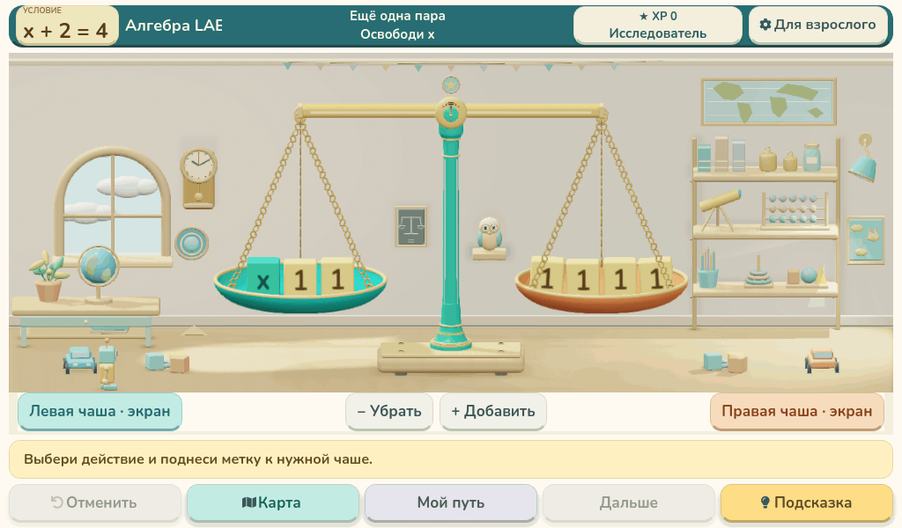

# Алгебра LAB — как работают весы

[Открыть MP4, 1024×600, 30 FPS](balance-actions-30fps.mp4)

20,5 секунды, 615 кадров. Демонстрация установленного приложения 0.38.0, фон продолжает двигаться.

- 0:00 — исходное условие x + 2 = 4.
- 0:01,5 — добавить 1 слева: чаша опускается.
- 0:03,5 — добавить 1 справа: равновесие возвращается.
- 0:05,5 — отменить полный ход.
- 0:07,5 — добавить 2 слева: наклон сильнее, пятый кубик укладывается сверху.
- 0:09,5 — отменить изменение одной чаши.
- 0:11 — убрать 1 справа.
- 0:13 — убрать 1 слева: обе чаши снова в равновесии.
- 0:15 — убрать ещё 1 слева.
- 0:17 — убрать ещё 1 справа: получаем x = 2.
- 0:19 — проверка ответа 2 и успешное завершение.

Действия проходят через штатную логику приложения и очередь симулятора RFID. Настоящие считыватели в записи не использованы. Исходное условие остаётся сверху слева. Код приложения и установочный пакет не изменены.

Для видео каждый кадр заново отрисован с шагом времени 1/30 с. Это покадровая демонстрация, а не замер FPS Raspberry Pi.
