# Кнопки и подписи — 0.41.0

Кадры настоящего .deb, экран 1024 × 600; служебные окна 800 × 520, карта 980 × 560. Комната OpenGL сохранена. 595 проверок кнопок/подписей без обрезаний или пересечений, 288 тестов. Проверка выполнена в облаке; физическая Pi 4 недоступна.

## Основной экран

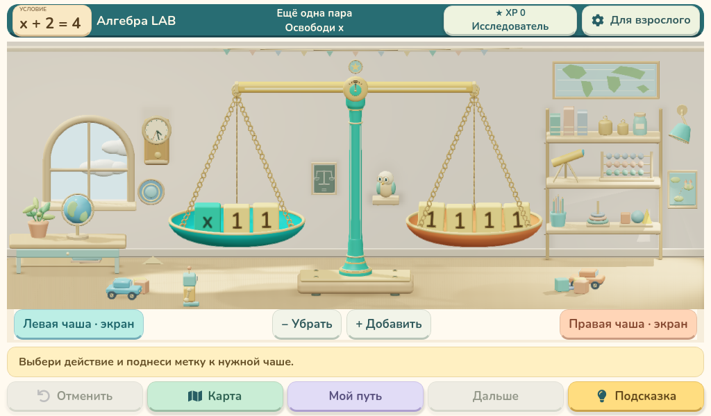

## Ввод ответа: стрелка и кнопка проверки

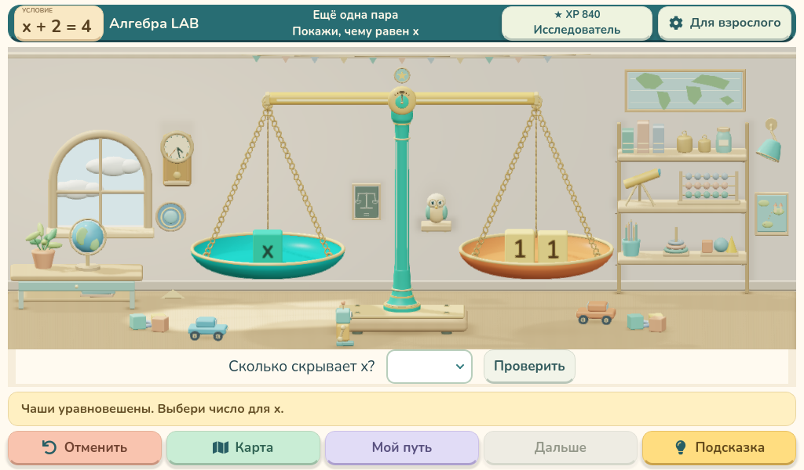

## Подтверждённый результат

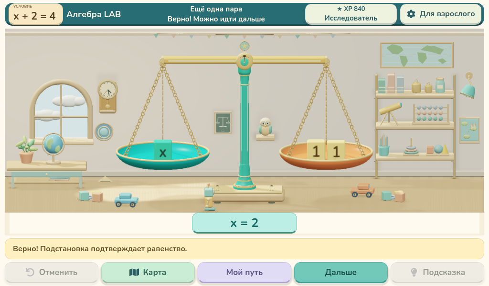

## Для взрослого

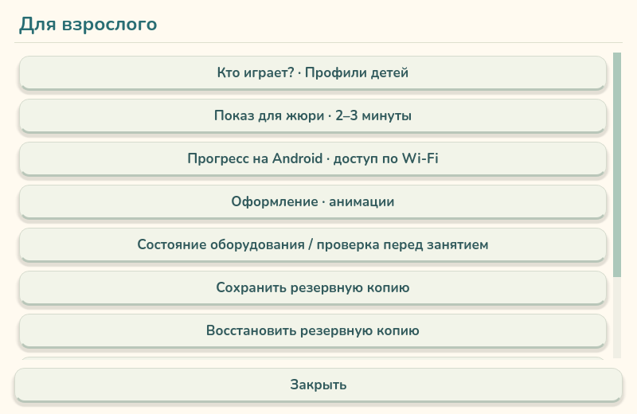

## Нижняя часть раздела для взрослого

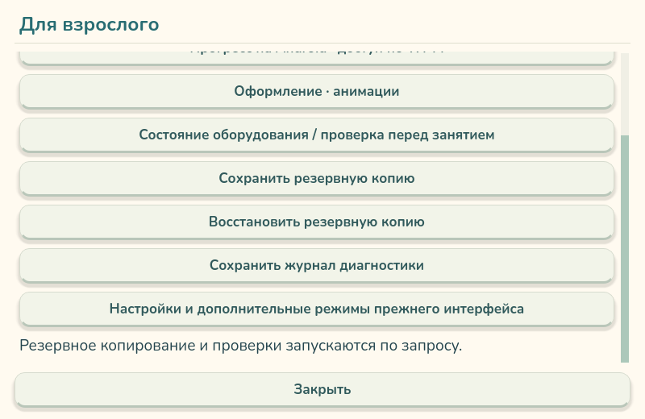

## Настройки оформления

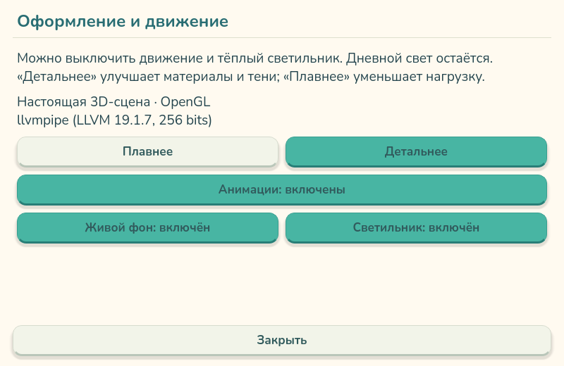

## Настройки с выключенными эффектами

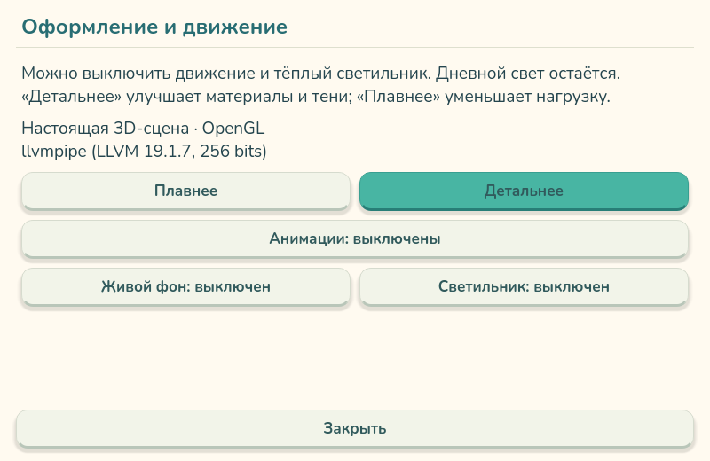

## Профили

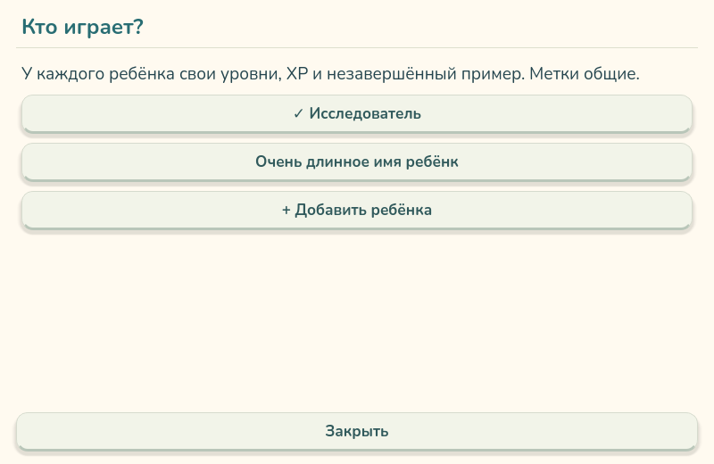

## Карта: доступные и закрытые уровни

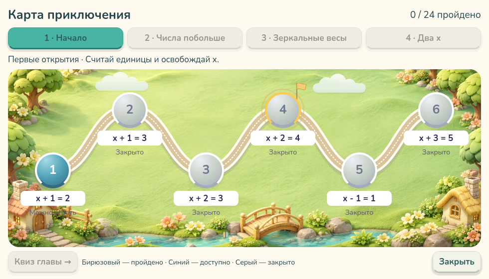

## Карта: пройденные уровни

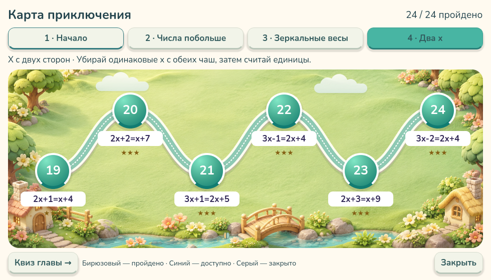

## Квиз

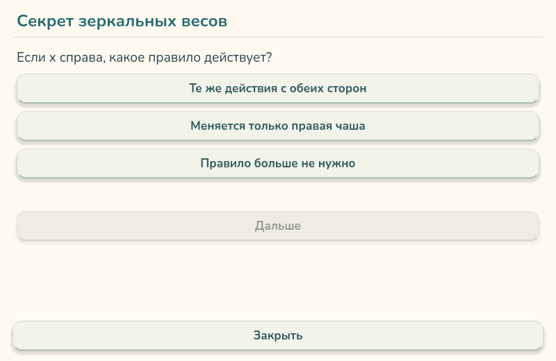

## Android

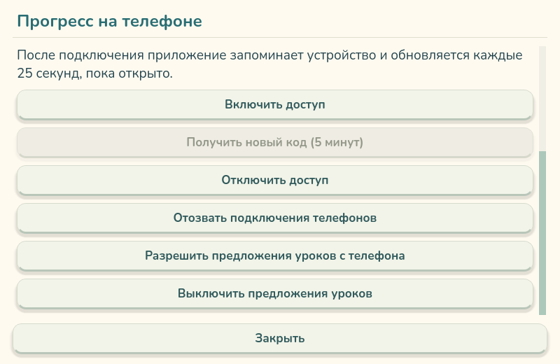

Остальные кадры: [adult.png](adult.png), [adult-bottom.png](adult-bottom.png), [profiles.png](profiles.png), [appearance.png](appearance.png), [phone.png](phone.png), [phone-bottom.png](phone-bottom.png), [hardware.png](hardware.png), [history.png](history.png), [script.png](script.png), [script-bottom.png](script-bottom.png), [appearance-off.png](appearance-off.png), [new-profile.png](new-profile.png), [backup.png](backup.png), [restore.png](restore.png), [export-log.png](export-log.png), [confirmation.png](confirmation.png), [profiles-long.png](profiles-long.png), [map-locked-1.png](map-locked-1.png), [map-complete-1.png](map-complete-1.png), [map-complete-2.png](map-complete-2.png), [map-complete-3.png](map-complete-3.png), [map-complete-4.png](map-complete-4.png), [quiz-1-1.png](quiz-1-1.png), [quiz-1-2.png](quiz-1-2.png), [quiz-1-3.png](quiz-1-3.png), [quiz-2-1.png](quiz-2-1.png), [quiz-2-2.png](quiz-2-2.png), [quiz-2-3.png](quiz-2-3.png), [quiz-3-1.png](quiz-3-1.png), [quiz-3-2.png](quiz-3-2.png), [quiz-3-3.png](quiz-3-3.png), [quiz-4-1.png](quiz-4-1.png), [quiz-4-2.png](quiz-4-2.png), [quiz-4-3.png](quiz-4-3.png).

[Отчёт проверки](touch-layout-audit.json) · [Сохранённая логика](preservation-check.json) · [Все проверки](verification.json)
