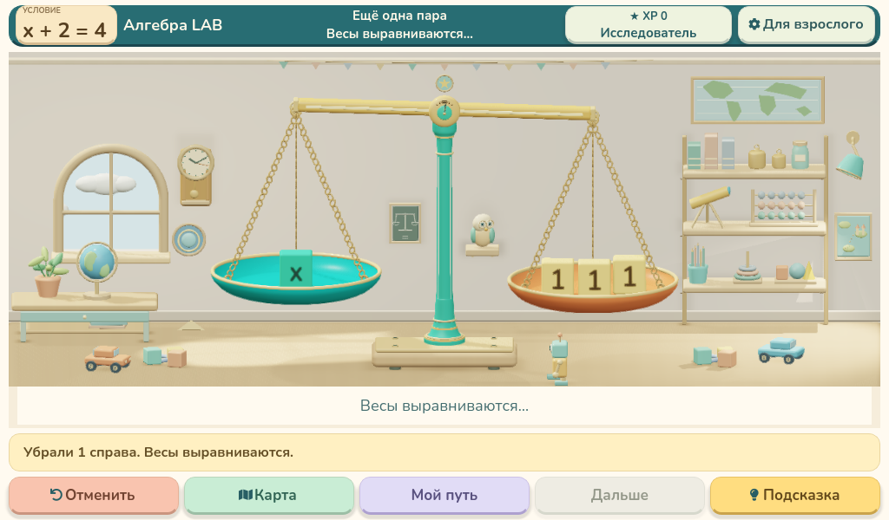
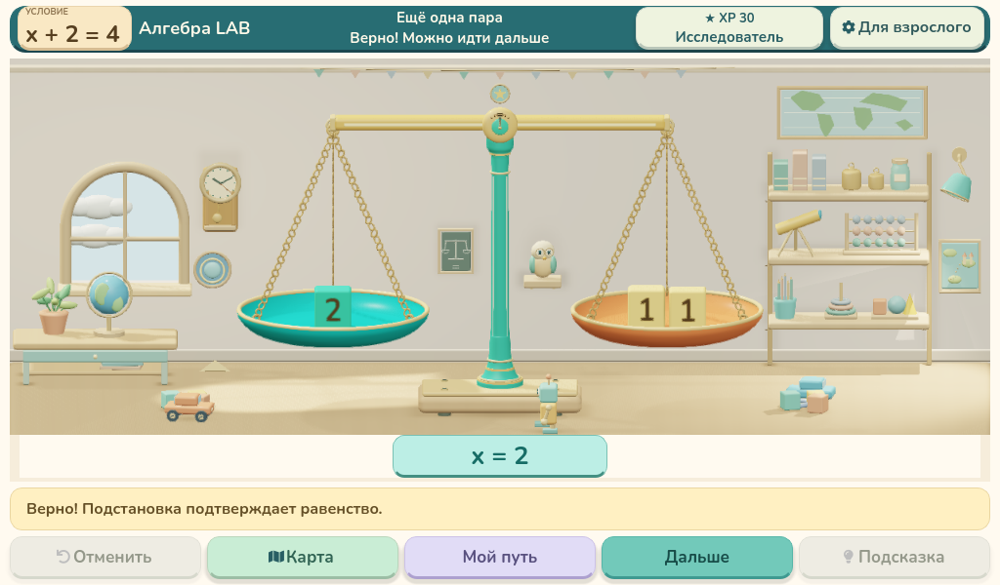
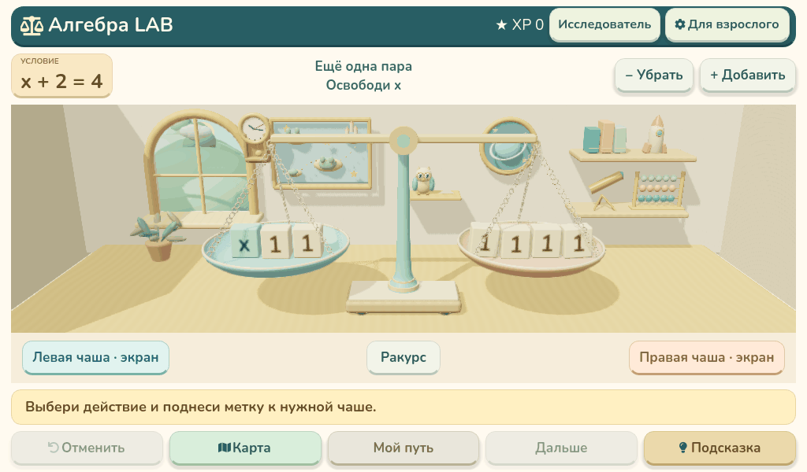

# Алгебра LAB 0.40.1 — порядок переходов

| Кубик уходит, вопрос скрыт | Весы ровные, появился вопрос | Проверенный результат |
|---|---|---|
|  |  |  |

Сначала завершается движение весов, затем вопрос проявляется за 180 мс. После проверки сохранён поворот x в 2; когда число читаемо, в полосе появляется плашка x = 2. Кнопка «Дальше» на прежнем месте. Сообщения короткие, «Исследователь» не обрезается, XP не сдвигает соседей.

Во всех 660 кадрах область комнаты — 1004×386, матрица камеры и положения верхней панели неизменны.

[MP4 22 секунды, 30 FPS](balance-actions-30fps.mp4)

Видео — покадровая демонстрация, не аппаратный замер FPS Raspberry Pi. Механика, RFID, кнопки и прогресс сохранены.
