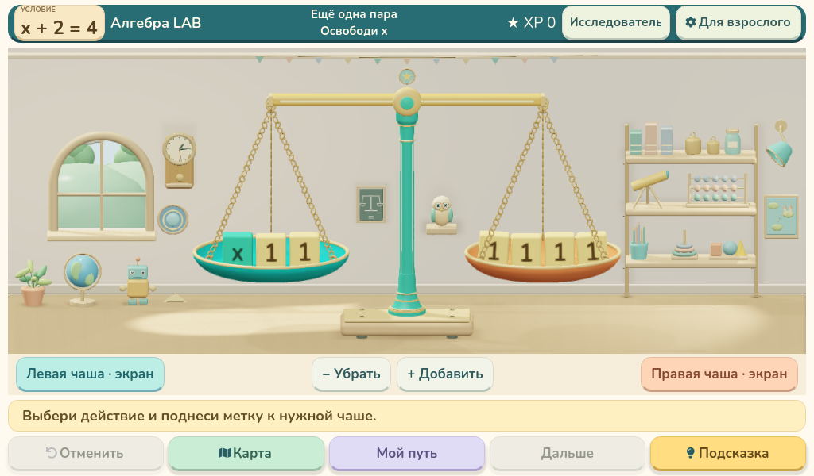
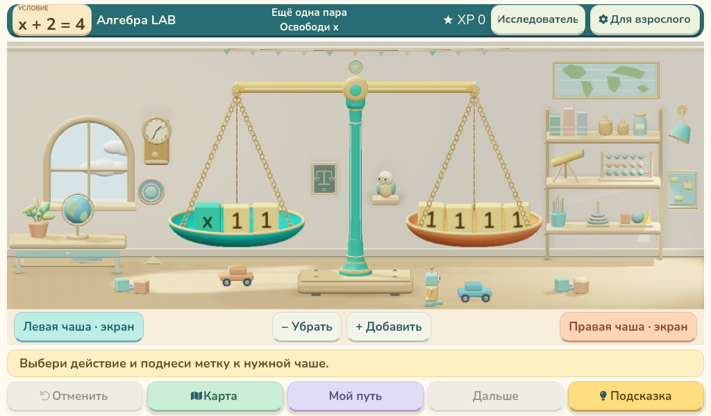

# Алгебра LAB 0.38.0 — новая игровая комната

| 0.37.0 | 0.38.0 |
|---|---|
|  |  |

Вид со второго/третьего этажа: за окном только небо и три слоя облаков. Горшок и глобус стоят на столике с ножками, ящиком и нижней полкой. На стене карта мира, на полу игрушки.

Робот проходит весь передний план (11,6 единицы сцены), разворачивается и возвращается; руки и ноги двигаются. Две машинки с колёсами объезжают основание; голова совы поворачивается вправо и влево на 30°. Правая лампа даёт более заметное тёплое пятно. Контактные тени робота и машинок следуют за ними.

[Открыть MP4, 1024×600, 30 FPS](real-3d-30fps.mp4)

Камера, весы, игровая логика и пиксели внешнего интерфейса сохранены. Проверены маршрут без въезда в основание, разделение машинок и робота, размещение объектов в кадре и читаемость символов при движущемся декоре и крайних наклонах чаш. Видео отрисовано покадрово; это демонстрация движения, не замер FPS Raspberry Pi.
