# 72 уровня и метки 0–9 — 0.44.0

[Правила и установка](extended-lessons.md). Восемь новых глав после прежних четырёх. Снимки из распакованного .deb, 1024 × 600.

## Главы 5–8

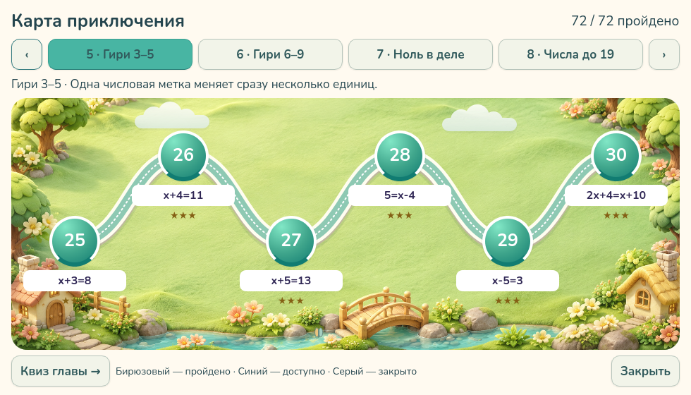

## Главы 9–12

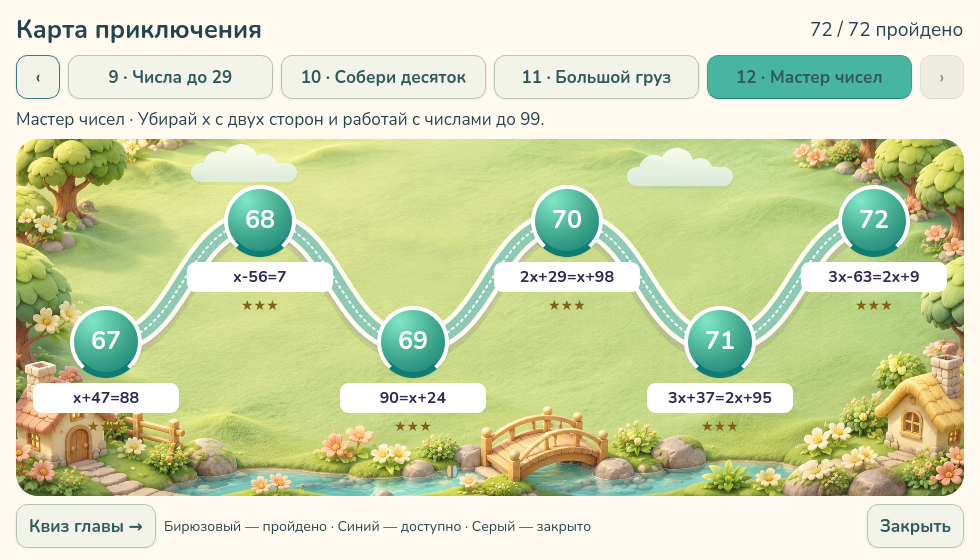

## Двузначные числа

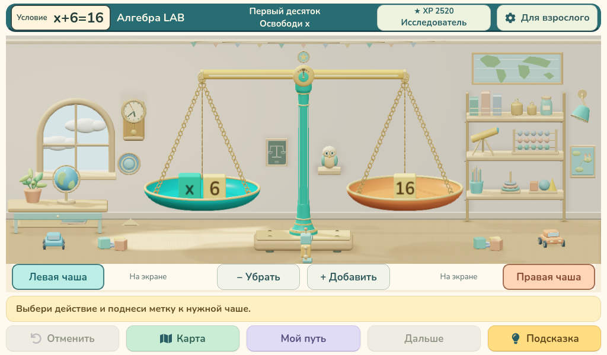

## Ввод ответа 10 метками

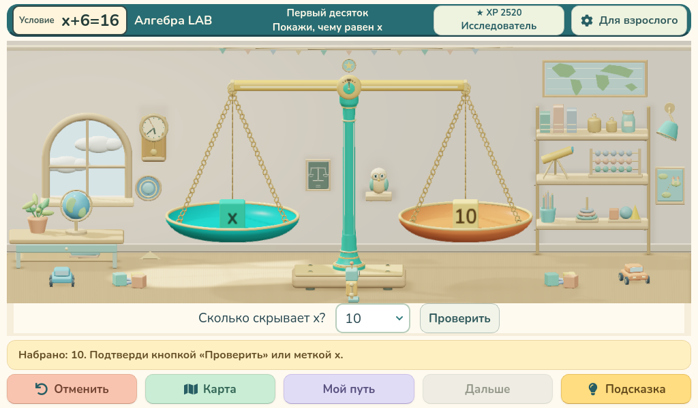

## Ответ 10

## Задание на ноль

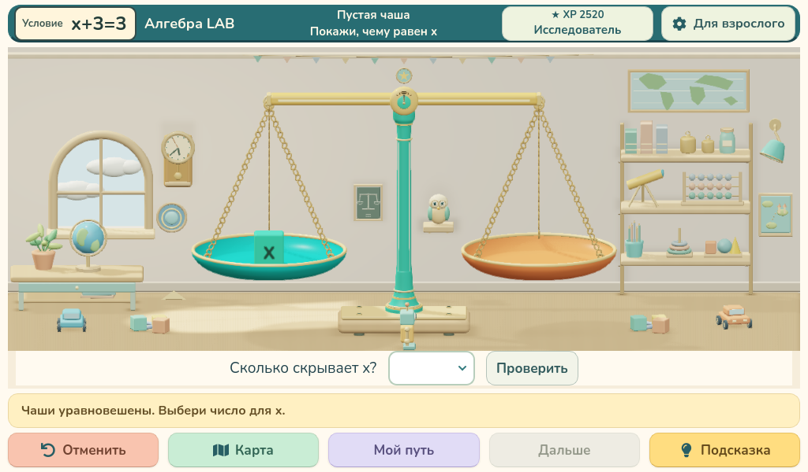

## Ответ 0

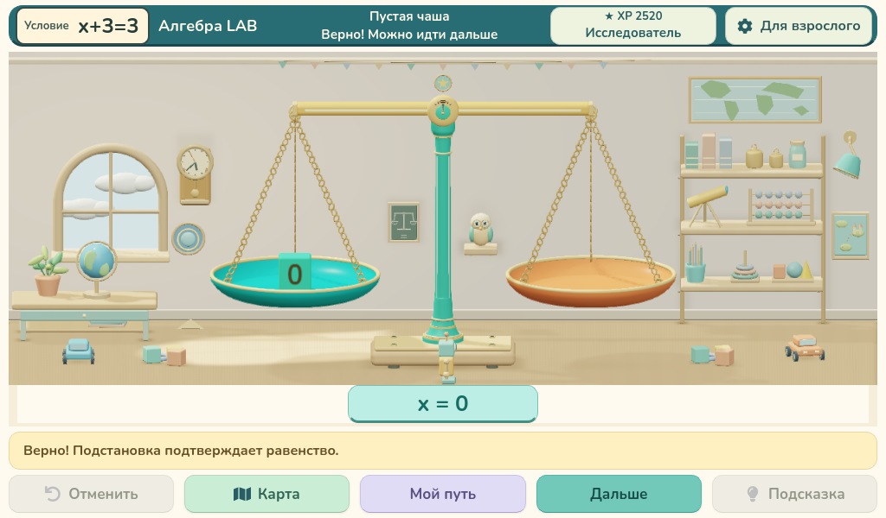

## Большие числа и x отдельно

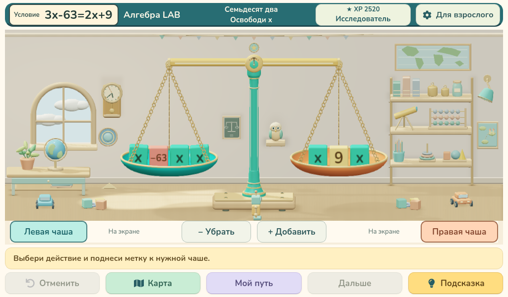

## Ответ 72 метками

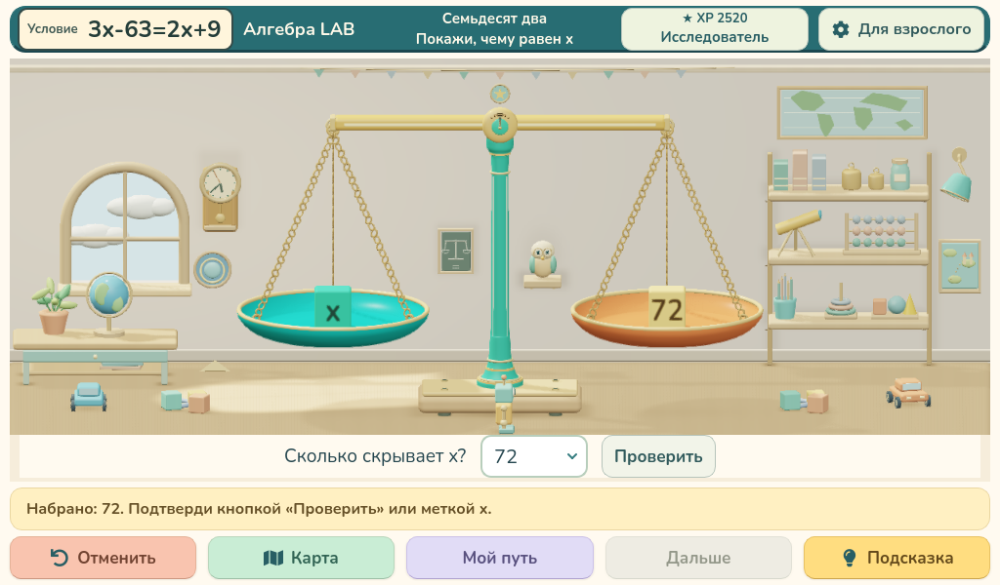

## Правильный ответ 72

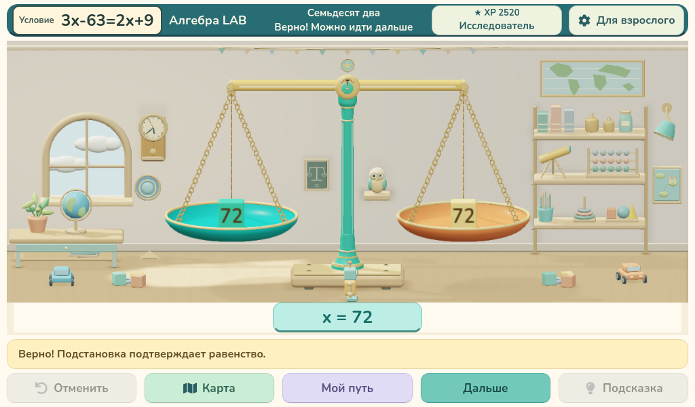

## Квиз новой главы

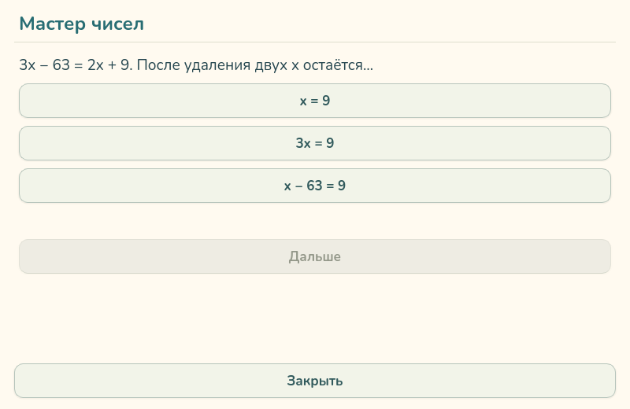

## Выбор числа на экране

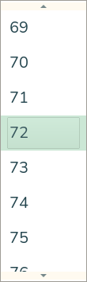

[Все проверки](verification.json) · [Совместимость](preservation-check.json) · [Каталог](catalog.json).

Физическая Pi недоступна; аппаратный FPS не измерен. Ракурс и геометрия комнаты сохранены.
