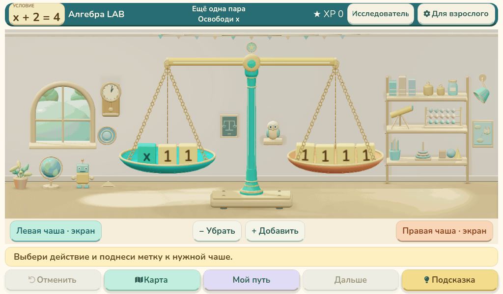

# Алгебра LAB — анимация 30 кадров/с

[Скачать MP4 в исходном разрешении 1024×600](real-3d-30fps.mp4)

20 секунд, 600 кадров, H.264, 30 кадров/с. На фоне движутся облака, робот, сова и часы; чаши плотные и матовые. Показаны полный длинный маршрут робота, оба разворота, движения рук и ног, две машинки с колёсами, повороты совы, облака и часы. Исходное уравнение сохраняется, ответ вводит ребёнок.

Кадры отрисованы установленным пакетом 0.38.0 в режиме «Детальнее». Для записи время физики продвигается покадрово с шагом 1/30 секунды; каждый кадр заново отрисовывается настоящим OpenGL-движком. Промежуточные изображения не сгенерированы интерполяцией. Код приложения и установочный DEB не изменены.

Это демонстрация движения, а не запись в реальном времени и не замер производительности Raspberry Pi. Время подготовки ролика может превышать его длительность.
